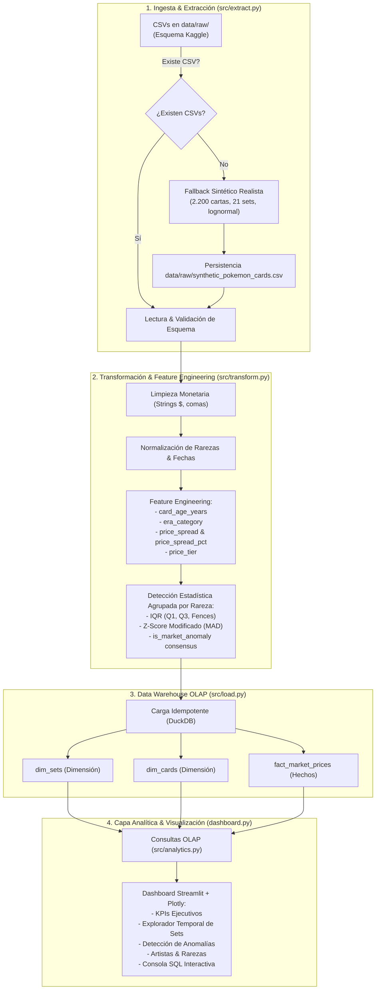
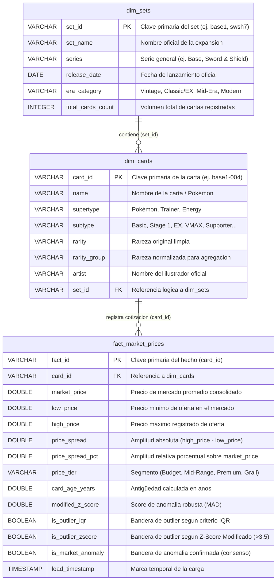

# ⚡ Pokémon TCG ETL & Market Analytics

[](https://www.python.org/)
[](https://duckdb.org/)
[](https://streamlit.io/)
[](https://plotly.com/)
[](LICENSE)

Pipeline ETL modular de ingeniería de datos y plataforma analítica interactiva sobre el mercado de cartas coleccionables de **Pokémon TCG**. Diseñado y construido bajo estándares de grado productivo para portfolios de **Senior Data Engineer**, utilizando **100% herramientas locales y gratuitas** (Python, Pandas, NumPy, SciPy, DuckDB, Streamlit y Plotly).

---

## 📋 Tabla de Contenidos
1. [Resumen Ejecutivo & Valor de Negocio](#-resumen-ejecutivo--valor-de-negocio)
2. [Arquitectura del Sistema](#-arquitectura-del-sistema)
3. [Modelo de Datos (Esquema Estrella OLAP)](#-modelo-de-datos-esquema-estrella-olap)
4. [Metodología Estadística de Detección de Anomalías](#-metodología-estadística-de-detección-de-anomalías)
5. [Estructura del Proyecto](#-estructura-del-proyecto)
6. [Instalación y Configuración](#-instalación-y-configuración)
7. [Guía de Ejecución](#-guía-de-ejecución)
8. [Dashboard Analítico Interactivo](#-dashboard-analítico-interactivo)
9. [Pruebas Automatizadas y Calidad](#-pruebas-automatizadas-y-calidad)
10. [Buenas Prácticas de Ingeniería](#-buenas-prácticas-de-ingeniería)

---

## 💼 Resumen Ejecutivo & Valor de Negocio

El mercado secundario de cartas coleccionables Pokémon presenta características dinámicas y altamente volátiles:
- Asimetría de liquidez entre cartas estándar y cartas míticas (*Grails*).
- Gran dispersión de precios (*spreads* de oferta y demanda) que oscilan desde centavos de dólar hasta miles de dólares.
- Presencia de especulación y picos atípicos en cartas vintage y modernas de arte alternativo (*Special Illustration Rares*).

Este proyecto implementa un flujo completo de datos que:
1. **Ingesta y consolida** datos crudos de mercado (estándar Kaggle Pokémon TCG), incorporando un **generador sintético de respaldo** realista con más de 2.000 cartas y 21 expansiones para funcionar de inmediato sin requerir descargas previas.
2. **Limpia, estandariza y enriquece** métricas de liquidez, antigüedad de cartas y eras cronológicas.
3. **Detecta anomalías de precios estratificadas por rareza** combinando el Rango Intercuartílico (**IQR**) con el **Z-Score Modificado (MAD)** para identificar picos de especulación y oportunidades de arbitraje sin falsos positivos.
4. **Carga transaccional e idempotente** en un Data Warehouse OLAP columnar embebido (**DuckDB**) bajo un diseño de **Esquema Estrella**.
5. **Expone métricas e insights ejecutivos** a través de una aplicación web interactiva multipestaña en **Streamlit y Plotly** con consola SQL incorporada.

---

## 🏛️ Arquitectura del Sistema



---

## 🗄️ Modelo de Datos (Esquema Estrella OLAP)

El almacenamiento se modeló siguiendo las mejores prácticas de modelado dimensional para bases de datos columnares analíticas (DuckDB), optimizando consultas analíticas masivas y agregaciones vectorizadas.



### Principio de Idempotencia
El proceso de carga (`load_to_duckdb`) utiliza transacciones explícitas de DuckDB (`conn.begin()` / `conn.commit()`) y operaciones `INSERT ... ON CONFLICT (...) DO UPDATE SET ...` a través de staging tables temporales en memoria. Esto asegura que re-ejecutar el pipeline N veces nunca duplique registros ni corrompa el Data Warehouse.

---

## 🎯 Metodología Estadística de Detección de Anomalías

### El Problema del Z-Score Ordinario en Precios Financieros
El Z-Score convencional presupone una distribución normal o gaussiana:
$$Z = \frac{x - \mu}{\sigma}$$
En mercados de coleccionables, este enfoque presenta dos fallas críticas:
1. **Contaminación de la Media y Desviación Estándar:** Unos pocos valores extremos astronómicos (ej. *Charizard 1st Edition* o *Moonbreon*) inflan artificialmente $\mu$ y $\sigma$, enmascarando anomalías reales en cartas estándar.
2. **Asimetría por Rareza:** Una carta *Secret Rare* de \$150 es normal en su contexto, pero una carta *Common* de \$20 es una anomalía masiva (especulación súbita en el metajuego).

### Solución Implementada: Estratificación + MAD + IQR
El pipeline agrupa las cartas por `rarity_group` y ejecuta en paralelo:

#### 1. Rango Intercuartílico (IQR) Agrupado:
$$\text{IQR} = Q_3 - Q_1$$
$$\text{Límite Superior} = Q_3 + 1.5 \times \text{IQR}$$
$$\text{Límite Inferior} = \max(0, Q_1 - 1.5 \times \text{IQR})$$
Se marca `is_outlier_iqr = True` si el precio excede estas cotas.

#### 2. Z-Score Modificado (Boris Iglewicz & David Hoaglin, 1993):
Utiliza la **Mediana** ($\tilde{x}$) y la **Desviación Absoluta de la Mediana** (**MAD**), dos estimadores con el punto de ruptura más alto posible (50% de contaminación tolerada):
$$\text{MAD} = \text{median}(|x_i - \tilde{x}|)$$
$$M_i = \frac{0.6745 \times |x_i - \tilde{x}|}{\text{MAD}}$$
Donde $0.6745$ es el factor de consistencia para distribuciones normales estándar.
Se marca `is_outlier_zscore = True` cuando $M_i > 3.5$ (umbral crítico estándar de la literatura).

#### 3. Consenso de Anomalía de Mercado:
Una carta recibe la etiqueta `is_market_anomaly = True` cuando:
$$\text{is\_market\_anomaly} = (\text{is\_outlier\_iqr} \land \text{is\_outlier\_zscore}) \lor (M_i > 6.0)$$

---

## 📂 Estructura del Proyecto

```text
pokemon-tcg-etl-analytics/
├── data/
│   ├── raw/                           # Directorio para CSVs crudos de Kaggle
│   │   ├── .gitkeep                   # Mantiene la carpeta en Git
│   │   └── synthetic_pokemon_cards.csv# CSV sintético generado como fallback
│   └── pokemon_market.duckdb          # Data Warehouse OLAP generado por DuckDB
├── src/
│   ├── __init__.py                    # Inicialización del paquete modular
│   ├── extract.py                     # Extracción, validación de esquema y fallback sintético
│   ├── transform.py                   # Limpieza monetaria, features y detección de anomalías
│   ├── load.py                        # DDL de Esquema Estrella y carga idempotente en DuckDB
│   └── analytics.py                   # Consultas OLAP y KPIs analíticos sobre DuckDB
├── tests/
│   └── test_pipeline.py               # Suite de pruebas unitarias y de integración (unittest)
├── run_pipeline.py                    # Orquestador CLI principal del pipeline ETL
├── dashboard.py                       # Aplicación interactiva Streamlit + Plotly (5 pestañas)
├── requirements.txt                   # Dependencias de producción
├── .gitignore                         # Archivos temporales, caches y DuckDB ignorados
└── README.md                          # Documentación técnica completa del proyecto
```

---

## 🚀 Instalación y Configuración

### Prerrequisitos
- **Python 3.10 o superior** (probado en Python 3.12).
- Gestor de paquetes `pip`.

### 1. Clonar el Repositorio
```bash
git clone https://github.com/tu-usuario/pokemon-tcg-etl-analytics.git
cd pokemon-tcg-etl-analytics
```

### 2. Crear y Activar un Entorno Virtual
```bash
# Windows (PowerShell)
python -m venv .venv
.venv\Scripts\Activate.ps1

# Linux / macOS
python3 -m venv .venv
source .venv/bin/activate
```

### 3. Instalar Dependencias
```bash
pip install -r requirements.txt
```

---

## ⚙️ Guía de Ejecución

### Ejecución del Pipeline ETL Completo
Para ejecutar la ingesta, limpieza, modelado y carga en DuckDB:
```bash
python run_pipeline.py
```

#### Opciones de Línea de Comandos (CLI):
```bash
# Forzar la regeneración de datos sintéticos realistas:
python run_pipeline.py --force-synthetic

# Especificar un directorio alternativo de datos crudos:
python run_pipeline.py --raw-dir mis_datos_crudos/

# Especificar una ruta personalizada para el archivo DuckDB:
python run_pipeline.py --db-path data/almacen_alternativo.duckdb
```

#### Salida Típica en Consola:
```text
================================================================================
     POKÉMON TCG - ETL & ANALYTICS PIPELINE (PORTFOLIO DATA ENGINEERING)
================================================================================
    Stack: Python 3.12 | Pandas | NumPy | SciPy | DuckDB (OLAP) | Plotly
================================================================================

[INFO] [FASE 1/3] EXTRACCIÓN DE DATOS: 2,200 registros consolidados.
[INFO] [FASE 2/3] TRANSFORMACIÓN, LIMPIEZA & DETECCIÓN ESTADÍSTICA:
       133 outliers IQR, 118 outliers Z-Score, 105 anomalías confirmadas (4.8%).
[INFO] [FASE 3/3] CARGA IDEMPOTENTE EN DUCKDB:
       dim_sets: 21 | dim_cards: 2,200 | fact_market_prices: 2,200
[INFO] [POST-LOAD CHECK] RESUMEN ANALÍTICO Y VERIFICACIÓN DE INTEGRIDAD:
  • Total de cartas en almacén:        2,200
  • Total de sets catalogados:         21
  • Precio mediano de mercado:         $1.11
  • Spread promedio de mercado:        45.54%
  • Anomalías estadísticas detectadas: 105 (4.77% del mercado)
[INFO] PIPELINE FINALIZADO CON ÉXITO en 0.59 segundos.
```

---

## 📊 Dashboard Analítico Interactivo

Inicia la aplicación de visualización ejecutando:
```bash
streamlit run dashboard.py
```
Abre en tu navegador `http://localhost:8501`.

### Módulos del Dashboard:
1. **Resumen Ejecutivo & KPIs:** Métricas macroeconómicas, precio mediano por era histórica, top 10 sets más cotizados y carta insignia del mercado.
2. **Explorador de Sets & Eras:** Análisis longitudinal en línea de tiempo (Fecha vs Mediana de precio) con filtros dinámicos y tabla analítica detallada.
3. **Detección Estadística de Anomalías:** Mapa de dispersión interactivo (Precio vs Modified Z-Score) con línea de corte en $M_i = 3.5$, filtros por rareza y listado de cartas anómalas.
4. **Artistas & Rarezas:** Boxplots interactivos con escala logarítmica opcional, ranking de ilustradores con cartas más cotizadas y gráfico *Sunburst* de supertipos y rarezas.
5. **Data Warehouse & Consola SQL:** Visor interactivo del DDL del Esquema Estrella, ejecución libre de consultas SQL sobre DuckDB en milisegundos, consultas predefinidas y exportación a CSV.

---

## 🧪 Pruebas Automatizadas y Calidad

El proyecto incluye pruebas unitarias y de integración en `tests/test_pipeline.py` para garantizar la robustez del código:
- **Validación del generador sintético:** Esquema canónico Kaggle, volumen mínimo (>1.500 cartas) y representatividad de sets (>15 sets).
- **Limpieza monetaria:** Conversión de cadenas con símbolos `$`, comas, valores nulos o negativos a números válidos.
- **Detección estadística:** Coherencia de tipos y cálculo correcto de IQR y Z-Score Modificado.
- **Idempotencia en DuckDB:** Verificación de inserciones repetidas sin duplicidad de datos en dimensiones ni hechos.

Para ejecutar la suite de pruebas:
```bash
python -m unittest tests/test_pipeline.py -v
```

---

## 🛡️ Buenas Prácticas de Ingeniería

- **Sin Notebooks en Producción:** Todo el pipeline está escrito en módulos Python puros (`.py`), estructurados con tipado estático (`typing`), modularidad y separación de responsabilidades (SOLID).
- **Logging Estructurado:** Trazabilidad completa con marcas temporales, niveles de severidad y módulos identificados en consola.
- **Tolerancia a Fallos y Fallback Automático:** Si no hay datos crudos descargados, el pipeline nunca falla; activa el generador sintético de respaldo y continúa sin interrupciones.
- **Data Warehouse In-Process (DuckDB):** Cero dependencias externas de servidores (no requiere Docker, Postgres ni Spark para funcionar al 100%), permitiendo portabilidad inmediata y consultas OLAP en milisegundos.
- **Código Documentado:** Comentarios exhaustivos en español en cada función y docstrings detallados.

---

## 👤 Autor
Desarrollado como proyecto de portfolio de **Ingeniería de Datos y Analítica**.  
Listo para desplegar y compartir en repositorios públicos de GitHub.
