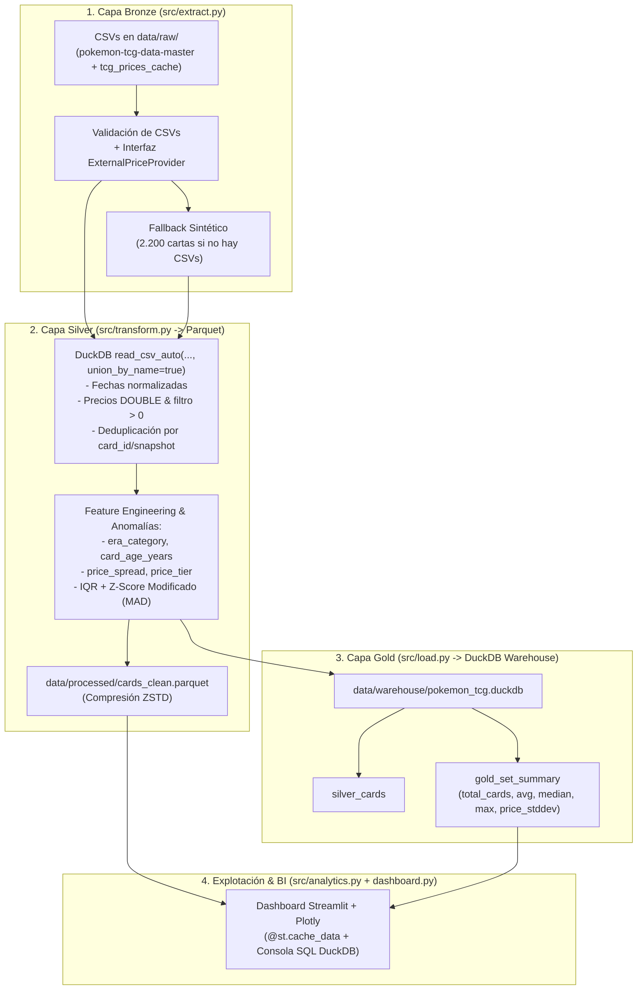

# Pokémon TCG ETL & Market Analytics

[](https://www.python.org/)
[](https://duckdb.org/)
[](https://parquet.apache.org/)
[](https://streamlit.io/)
[](https://plotly.com/)

Pipeline ETL modular de ingeniería de datos y plataforma analítica interactiva sobre el mercado secundario de **Pokémon TCG**, diseñado bajo una arquitectura **Medallion (Bronze → Silver → Gold)** con **DuckDB** y almacenamiento columnar **Apache Parquet**.

---

## Arquitectura Medallion



---

## Stack Técnico

- **Lenguaje:** Python 3.12+
- **Motor OLAP:** DuckDB (`read_csv_auto`, SQL vectorizado, exportación `COPY ... TO ... (FORMAT PARQUET)`)
- **Almacenamiento Columnar:** Apache Parquet (`pyarrow` / ZSTD)
- **Procesamiento & Estadística:** Pandas, NumPy, SciPy (IQR y Z-Score Modificado / MAD estratificado por rareza)
- **Visualización:** Streamlit + Plotly (diseño editorial oscuro con `@st.cache_data`)
- **Calidad & CI/CD:** Pytest + GitHub Actions (`.github/workflows/etl_pipeline.yml`)

---

## Estructura del Proyecto

```text
pokemon-tcg-etl-analytics/
├── .github/workflows/
│   └── etl_pipeline.yml          # CI: ejecuta run_pipeline.py y pytest
├── .streamlit/
│   └── config.toml               # Tema oscuro editorial y toolbar minimal
├── data/
│   ├── raw/                      # Capa Bronze (CSVs crudos / caché de precios)
│   ├── processed/
│   │   └── cards_clean.parquet   # Capa Silver columnar exportada desde DuckDB
│   └── warehouse/
│       └── pokemon_tcg.duckdb    # Data Warehouse DuckDB (silver_cards + gold_set_summary)
├── src/
│   ├── __init__.py
│   ├── extract.py                # Validación Bronze, proveedor externo desacoplado y fallback sintético
│   ├── transform.py              # Limpieza SQL DuckDB, feature engineering y anomalías (IQR + MAD)
│   ├── load.py                   # Persistencia DuckDB (Silver + Gold) y exportación Parquet
│   └── analytics.py              # Consultas OLAP sobre DuckDB y Parquet
├── tests/
│   └── test_pipeline.py          # Tests unitarios y de integración (esquemas, Parquet, idempotencia)
├── run_pipeline.py               # Orquestador CLI (Extract -> Transform -> Load)
├── dashboard.py                  # Dashboard analítico interactivo en Streamlit + Plotly
├── requirements.txt
└── README.md
```

---

## Ejecución en Local

### 1. Crear entorno virtual e instalar dependencias
```powershell
python -m venv .venv
.\.venv\Scripts\python.exe -m pip install -r requirements.txt
```

### 2. Ejecutar el Pipeline ETL completo
```powershell
.\.venv\Scripts\python.exe run_pipeline.py
```
Opciones CLI disponibles:
- `--force-synthetic`: fuerza el dataset sintético (útil en entornos sin CSVs).
- `--raw-dir`: ruta alternativa de datos crudos (`data/raw` por defecto).
- `--db-path`: ruta del warehouse DuckDB (`data/warehouse/pokemon_tcg.duckdb` por defecto).
- `--parquet-path`: ruta del Parquet Silver (`data/processed/cards_clean.parquet` por defecto).

### 3. Ejecutar las pruebas automatizadas
```powershell
.\.venv\Scripts\python.exe -m pytest -v
```

### 4. Lanzar el Dashboard Analítico
```powershell
.\.venv\Scripts\python.exe -m streamlit run dashboard.py
```
Abrir en el navegador `http://localhost:8501`.
